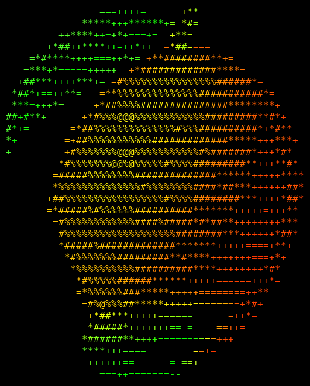

<p align="center"></p>

# Mangue OS

**A small, headless-friendly Debian for the MangoPi MQ Pro.** Flash it, type your Wi-Fi and a username
into a text file on your PC, boot the board, and SSH in. No screen, no keyboard, no serial adapter.

*Mangue* is French for mango. Don't ask me why I named it that, out of everything else. I couldn't think of anything else.
It's Debian 13 (trixie), built with the [Armbian build framework](https://github.com/armbian/build) for the MQ Pro's Allwinner D1 (RISC-V).

## Why not just use stock Armbian?

You can. Mangue OS is built from it. But the stock `mangopi-mq` image is a community board with no
maintainer, and on a real board it shows:

- a **6.1 release-candidate kernel** that gets no security fixes,
- first login only on a **console**, as `root` / `1234`, with root SSH allowed,
- Wi-Fi that **wedged within minutes** of connecting,
- HDMI that gave **no picture** on a 2K monitor,
- a header you can only use by **editing device trees by hand**,
- and a wizard that sends your public IP to two geolocation services without asking.

Mangue OS fixes all of that:

- **Linux 6.18 LTS** with the D1 bits ported forward: HDMI console, hardware PWM, MQ Pro device tree
- **Set up from your PC:** `mangue-setup.txt` on the card does the user, Wi-Fi, hostname, timezone,
  language and SSH on first start. Edit it again later to change things; passwords are erased after use
- **One-cable access:** plug the board into your PC over USB-C and `ssh you@10.55.0.1` (it shows up as a
  network adapter + serial port, no drivers on Windows 11)
- **Wi-Fi that stays up:** 24 h test with no reset and no wedge, plus automatic driver recovery
- **Header ready to use:** 43 overlays (I2C, SPI, UART, PWM, CAN, 1-Wire, IR, …) switched with
  `mqpro-io`, which refuses pin conflicts. Pins named by header pin number (`P11`), Raspberry Pi pin lookup,
  GPIO/I2C/SPI without sudo, ~300 extra sensor/bus drivers
- **Safer defaults:** no default login, no root SSH, no telemetry, nothing phones home
- **Less SD wear:** no background update jobs, logs in RAM; hardware watchdog on

**What it doesn't do:** no desktop or video playback (the D1 has no GPU), HDMI is a 1080p/720p/480p text
console, Wi-Fi is 2.4 GHz only, and the kernel doesn't update through `apt` (Debian packages do; a new
kernel means a new image). The header overlays haven't been tested with real parts yet.

The full side-by-side, including Tina Linux and Ubuntu: **[docs/comparison.md](docs/comparison.md)**.

## Getting started

1. Download the `.img.xz` from **[Releases](../../releases)**.
2. Flash it with Raspberry Pi Imager ("Use custom") or balenaEtcher. When Imager offers
   "OS customisation", say **No**; that's for Raspberry Pi OS.
3. Put the card back in your PC, open the **MANGUEOS** drive, and fill in `mangue-setup.txt` (it explains
   itself). If Windows offers to format a drive, click **Cancel**.
4. Card in the board, power on, wait 3–5 minutes, then `ssh yourname@mqpro.local`.

Prefer a screen and keyboard? Leave the setup file empty and a setup wizard runs on the console instead.
All the details, including the known issues: **[RELEASE_NOTES.md](RELEASE_NOTES.md)**.

## Using the header

```sh
mqpro-io list                     # every overlay and whether it's on
mqpro-io pin GPIO17               # Raspberry Pi pin name -> MQ Pro pin
sudo mqpro-io enable i2c0-pins3-5 # then reboot; pins 3/5 become /dev/i2c-0
gpioget P11                       # read a pin by its header number
```

Pin map: **[docs/pinmap.md](docs/pinmap.md)**. Header I/O is 3.3 V (pins 27/28 are 2.8 V).

## Status

Version 0.1, the first release. Both setup paths, changing settings from the card, Wi-Fi, USB-C, HDMI and
repeated reboots are tested on hardware. The header overlays with real devices attached are next.

**Tested from Windows 11 only.** Everything on the PC side was done on a Windows 11 laptop: editing
`mangue-setup.txt` in Notepad, SSH and the USB-C network/serial connection, and building the image (in
WSL2 with Ubuntu 24.04 and Docker). Nobody has tried it from **macOS** or a **native Linux** PC yet, so
flashing, editing the setup file, USB-C access and building from those are untested. They should work
(the card's setup partition is plain FAT, USB-C uses standard drivers, Armbian builds on Linux), but if
you try, please open an issue and say how it went.
Bug reports and test results with real sensors are very welcome: open an issue.

## Building it yourself

You need an x86-64 Linux machine (or WSL2, working on its Linux filesystem, not `/mnt/c`) with Docker,
and 25 GB or more of free disk. Release 0.1 was built in WSL2 (Ubuntu 24.04) on Windows 11; a native
Linux build is untested.

```sh
git clone https://github.com/armbian/build armbian-build
cd armbian-build
git checkout 813ae7cf3ccd40df1d287733e1838ed0812ceeb8   # the framework commit 0.1 was built with
cp -r /path/to/this/repo/userpatches .
./compile.sh mangueos
```

The image lands in `output/images/`. What's where:

| Path | What |
|---|---|
| `userpatches/config-mangueos.conf` | Build profile (board `mangopi-mq`, branch `current`, trixie, minimal) |
| `userpatches/kernel/archive/d1-6.18/` | Kernel patches on top of Linux `v6.18.56`: D1 HDMI, D1 PWM, MQ Pro DT, header overlays, bus aliases, GPIO line names |
| `userpatches/linux-d1-current.config` | Kernel config |
| `userpatches/u-boot/` | U-Boot patch (overlay load address); U-Boot itself is smaeul's `d1-wip` |
| `userpatches/customize-image.sh` | Image customisation: services, setup, branding, wizard fixes |
| `userpatches/overlay/mangueos/` | Files installed into the image (`mangue-setup`, `mqpro-io`, systemd units, …) |
| `overlays/header_table.py` | Single source for header pins and overlays; `tools/gen_overlays.py` generates the overlays, kernel patches 0013/0014 and `mqpro-io.json` |
| `tools/` | Dev helpers: overlay generator, kernel-config helper, offline image checker, serial test scripts, soak and benchmark tools. Some expect the Armbian tree at `~/mangopi_mqpro/build`; change the path if yours lives elsewhere |
| `docs/` | Pin map, comparison with other OS options |
| `branding/` | Logo sources and converters |

## Credits

- [Armbian](https://github.com/armbian/build): build framework, board support, first-login wizard
- Samuel Holland ([smaeul](https://github.com/smaeul)): D1 U-Boot and the D1 HDMI work the HDMI patches
  are ported from
- The authors of the sun20i PWM driver series (see the patch headers)
- [easytarget/MQ-Pro-IO](https://github.com/easytarget/MQ-Pro-IO): MQ Pro header pin map
- Debian

## License

GPL-2.0, see [LICENSE](LICENSE). Kernel and U-Boot patches keep the authorship and sign-offs in their
headers. The images contain Debian packages and firmware under their own licenses
(`/usr/share/doc/*/copyright` on the board). The kernel and U-Boot sources for each release are the
upstream versions named above plus the patches in this repository.
